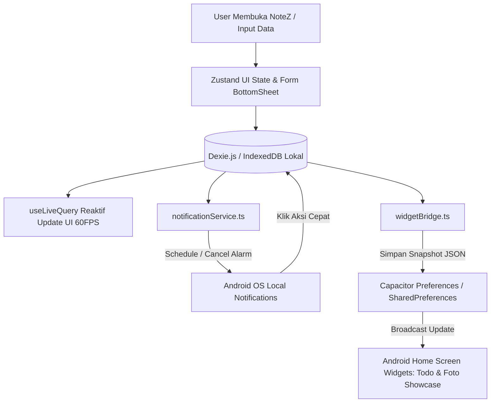

# PRD — NoteZ v2.0 (Pure Offline Edition)

> Dokumen ini adalah **sumber kebenaran (Single Source of Truth)** project NoteZ v2.0. Kode mengikuti PRD. Jika kebutuhan berubah, ubah PRD dulu, baru kodenya.

---

## 0. Ringkasan

- **Produk**: Aplikasi *super-app* produktivitas dan pencatatan harian pribadi *all-in-one* (Keuangan, To-Do & Habit, Smart Notes, Media/Anime Watchlist, dan Wishlist Tabungan) bergaya Neo-Brutalism yang dilengkapi *Android Home Screen Widget* dan notifikasi pintar.
- **Untuk siapa**: Pelajar, mahasiswa, pekerja, dan kreator yang membutuhkan satu aplikasi pencatatan harian serba lengkap, cepat, *offline-first*, dan tampil langsung di layar utama HP Android.
- **Masalah yang diselesaikan**: Mengatasi masalah pencatatan harian yang terpecah di banyak aplikasi serta kendala *lag/freeze* pada NoteZ v1.1 akibat penggunaan `localStorage` *synchronous* dan `setInterval` notifikasi.
- **Stack utama**: Next.js 15 (`output: 'export'` / Static SPA), TypeScript, Tailwind CSS v4, Dexie.js (IndexedDB), Zustand, Capacitor v6, Android Studio (Kotlin untuk Native AppWidget).
- **Status project**: Perencanaan (Siap masuk Fase 1 Implementasi)
- **Terakhir diperbarui**: 30 Oktober 2026

---

## 1. Overview

### 1.1 Latar Belakang
Pada versi sebelumnya (**NoteZ v1.1**), aplikasi mengalami beberapa kendala krusial saat digunakan sehari-hari di perangkat Android:
1. **Performa Lemot (Main-Thread Blocking)**: Penyimpanan menggunakan `localStorage` (`storage.ts`) yang bersifat *synchronous*, sehingga proses `JSON.parse` dan `JSON.stringify` memblokir UI saat data transaksi dan tugas semakin banyak.
2. **Beban Memori dari Polling Notifikasi**: Pengecekan *deadline* menggunakan `setInterval` di *main thread* yang memicu *re-render* berulang pada `app/(app)/layout.tsx` dan menguras baterai.
3. **Kompleksitas Dual-Storage**: Sinkronisasi prematur ke Supabase menyebabkan *race condition* dan *freeze* saat sinyal lemah.
4. **Fitur Belum Menyeluruh**: Belum adanya fitur pencatatan teks bebas (*Smart Notes*), multi-dompet keuangan, anggaran/tagihan rutin, pencatatan tontonan (*Film/Anime/Series*), sinkronisasi waktu HP *real-time*, serta ketiadaan *Home Screen Widget* di layar utama HP.

Oleh karena itu, **NoteZ v2.0** dibangun ulang dari nol (*recreate*) dengan filosofi **100% Pure Offline-First**, arsitektur *asynchronous* menggunakan **IndexedDB (Dexie.js)**, sistem notifikasi berbasis *event* native Android, dan dukungan **Widget Layar Utama HP**.

### 1.2 Tujuan
- **T-01**: Menghilangkan *lag* antarmuka hingga mencapai waktu muat halaman dan aksi simpan data $< 50\text{ ms}$ (60 FPS stabil di Android WebView) dengan migrasi penuh dari `localStorage` ke `Dexie.js (IndexedDB)`.
- **T-02**: Mengintegrasikan 5 modul kehidupan harian (Keuangan Lengkap, To-Do & Habit, Catatan Pintar, Media/Anime Watchlist, dan Wishlist Impian) dalam satu aplikasi tanpa perlu koneksi internet.
- **T-03**: Menyediakan sistem pengingat otomatis yang presisi dan hemat baterai menggunakan alarm sistem Android (`@capacitor/local-notifications`) yang tersinkronisasi 100% dengan jam dan zona waktu perangkat HP.
- **T-04**: Menghadirkan 2 jenis **Android Home Screen Widget** (Widget Tugas Hari Ini & Widget Sticky Note/Showcase Foto) agar pengguna bisa melihat tugas dan target langsung dari layar beranda HP tanpa membuka aplikasi.

### 1.3 Target User (Persona)
| Peran | Deskripsi | Kebutuhan utama | Kendala saat ini |
|-------|-----------|-----------------|------------------|
| **Pengguna Utama (Self-User / Mahasiswa / Pekerja)** | Pengguna aktif HP Android yang ingin mengatur uang, jadwal tugas, kebiasaan, catatan cepat, daftar tontonan anime/film, dan tabungan barang impian di satu tempat. | Input data super cepat (1 ibu jari), notifikasi tepat waktu sesuai jam HP, dan bisa melihat daftar tugas/catatan langsung di layar utama HP (Widget). | Aplikasi lama terasa berat saat data bertambah, lupa mencatat pengeluaran karena tidak ada pengingat malam, dan harus membuka aplikasi dulu hanya untuk melihat daftar tugas hari ini. |

### 1.4 Success Metrics
| Metrik | Kondisi sekarang (NoteZ v1.1) | Target (NoteZ v2.0) |
|--------|-------------------------------|---------------------|
| Waktu respons simpan/baca data lokal | $150\text{ ms} - 800\text{ ms}$ (*blocking* via `localStorage`) | $< 30\text{ ms}$ (*non-blocking* via `Dexie.js`) |
| Penggunaan CPU saat aplikasi *idle* | Tinggi (akibat `setInterval` notifikasi) | $\approx 0\%$ (*event-driven OS alarm* & komponen jam terisolasi) |
| Keandalan pergantian hari (Habit/Todo) | Sering meleset karena zona waktu UTC | $100\%$ akurat tepat pukul `00:00:00` mengikuti zona waktu lokal HP |
| Aksesibilitas informasi di layar utama HP | Tidak ada Widget (harus buka aplikasi) | Tersedia 2 Widget Native di Home Screen HP Android |

---

## 2. Scope

### 2.1 In Scope (Fase 1 / Full Offline Release)
- **Modul 1 — Dashboard & Header Global**: Jam digital *real-time* sinkron HP (`LiveDeviceClock`), *Quick Actions Bar*, ringkasan saldo multi-dompet, fokus tugas hari ini, lanjut nonton (*continue watching*), *pinned notes*, dan *global search*.
- **Modul 2 — Smart Finance Suite**: Pencatatan Pemasukan/Pengeluaran/Transfer antar dompet, Multi-Dompet (Tunai, Bank, E-Wallet) dengan fitur *Penyesuaian Saldo (Adjustment)*, Anggaran Bulanan per kategori, Tagihan Rutin bulanan, serta Catatan Utang & Piutang.
- **Modul 3 — Produktivitas (To-Do & Habit)**: Daftar tugas dengan prioritas, *sub-tasks* (checklist di dalam tugas), tugas berulang (*recurring*), *Pomodoro Focus Timer*, dan *Habit Tracker* harian dengan perhitungan *streak* otomatis.
- **Modul 4 — Smart Notes**: Catatan teks kaya fitur dengan *interactive checklist*, lampiran foto dari galeri HP, kode warna kartu, folder/tag, *pin* catatan, dan fitur tampilkan di Widget Layar HP.
- **Modul 5 — Tracker Hiburan & Impian**:
  - **Media & Watchlist Tracker**: Pencatatan Film, Anime, Series/Drakor, dan Video lengkap dengan tombol cepat `+1 Ep`, Sistem Rating Ganda (Skor `1.0 - 10.0` + Tier Badge `S/A/B/C/D`), sensor *spoiler*, dan pengingat hari tayang *on-going*.
  - **Wishlist & Celengan Impian**: Target tabungan barang impian dengan estimasi hari tercapai, potong saldo dompet langsung, dan pajang foto barang di Widget Layar HP.
- **Modul 6 — Sistem Pendukung & Native Android**:
  - Sistem Notifikasi 2-Lapis (Native Android Push Notification + In-App Notification Drawer dengan tombol aksi cepat).
  - Sinkronisasi Waktu & Zona Waktu Perangkat HP (`deviceTimeService`).
  - 2 Android Home Screen Widgets (`NoteZTodoWidget` & `NoteZShowcaseWidget`).
  - Fitur Backup & Restore mandiri 100% offline (`.JSON` & `.CSV`) serta *Brutal Dark Mode*.

### 2.2 Out of Scope (TIDAK boleh dikerjakan)
- **Sinkronisasi Cloud & Database Eksternal (Supabase/Firebase)**: Dilarang membuat integrasi jaringan ke database cloud pada fase ini.
- **Halaman Autentikasi (Login / Register / OAuth)**: Aplikasi langsung masuk ke `/dashboard` tanpa halaman login (opsional hanya kunci PIN lokal).
- **Fitur Kolaborasi Multi-User**: Aplikasi murni untuk penggunaan personal (*single-user offline*).
- **Server-Side Rendering (SSR) / Next.js API Routes**: Dilarang menggunakan fitur server Next.js karena dikompilasi sebagai paket statis (`out/`) untuk Capacitor Android.

### 2.3 Asumsi dan Batasan
- **Perangkat Target**: Smartphone Android (minimal Android 8.0 / API Level 26 ke atas) yang dikompilasi melalui Android Studio.
- **Penyimpanan**: Seluruh data disimpan di dalam perangkat pengguna menggunakan `IndexedDB` (kuota penyimpanan hingga ratusan MB, jauh di atas batas $5\text{ MB}$ milik `localStorage`).
- **Koneksi Internet**: Aplikasi wajib berjalan $100\%$ fungsional meskipun HP dalam kondisi *Airplane Mode* (Mode Pesawat).

---

## 3. Requirement

### 3.1 Functional
| ID | Requirement (spesifik dan bisa diuji) | Peran |
|----|---------------------------------------|-------|
| **FR-01** | Sistem wajib menampilkan jam, hari, tanggal, dan zona waktu (WIB/WITA/WIT) secara *real-time* mengikuti jam sistem HP, serta melakukan *auto-rollover* (reset habit harian & cek tugas terlambat) tepat pukul `00:00:00` waktu HP. | User |
| **FR-02** | User bisa membuat, mengedit, dan menghapus beberapa Dompet (*Tunai, Bank, E-Wallet*) serta melakukan **Penyesuaian Saldo (Balance Adjustment)** dengan memasukkan nominal saldo asli saat ini. | User |
| **FR-03** | User bisa mencatat transaksi **Pengeluaran**, **Pemasukan**, dan **Transfer Antar Dompet** (beserta biaya admin opsional) yang secara instan memperbarui saldo dompet terkait. | User |
| **FR-04** | User bisa menetapkan batas **Budget Bulanan** per kategori pengeluaran dan mencatat **Tagihan Rutin** bulanan yang bisa dibayar sekali klik (`Bayar Sekarang ⚡`). | User |
| **FR-05** | User bisa mencatat **Utang** dan **Piutang** beserta riwayat cicilan pelunasannya dan tanggal jatuh tempo. | User |
| **FR-06** | User bisa membuat **Tugas (To-Do)** dengan prioritas (`Tinggi`, `Sedang`, `Rendah`), *deadline*, *sub-tasks* (checklist bertingkat), jadwal pengulangan (`Harian/Mingguan/Bulanan`), serta menjalankan *Pomodoro Timer*. | User |
| **FR-07** | User bisa membuat **Habit Harian**, mencentang penyelesaian untuk hari ini, dan melihat jumlah *streak* beruntun beserta *heatmap* 30 hari terakhir. | User |
| **FR-08** | User bisa menulis **Smart Notes** dengan format teks tebal/miring, *checklist* interaktif, lampiran gambar dari galeri HP, memilih warna kartu, dan menyematkan (*pin*) catatan. | User |
| **FR-09** | User bisa mencatat daftar tontonan (**Anime, Film, Series, Video**), menekan tombol cepat `[ +1 Ep ]` untuk menambah progress episode, serta memberi rating **Skor (`1.0 - 10.0`)** dan **Tier (`S / A / B / C / D`)**. | User |
| **FR-10** | User bisa membuat **Wishlist Barang Impian** dengan foto barang, harga target, bintang prioritas, kalkulasi estimasi hari tercapai, dan menambah/menarik tabungan (dengan opsi potong langsung dari Dompet). | User |
| **FR-11** | Sistem wajib menjadwalkan **Native Android Notification** untuk *deadline* tugas, pengingat habit malam, pengingat catat keuangan malam, jatuh tempo tagihan/utang, *overbudget* ($\ge 80\%$), dan hari rilis episode Anime/Series *on-going*. | Sistem |
| **FR-12** | User bisa membuka **Laci Notifikasi (In-App Notification Drawer)** dan menekan tombol aksi langsung (*Selesaikan Tugas*, *Tunda 1 Jam*, *Catat Bayar*, *+1 Episode*) dari dalam kartu notifikasi. | User |
| **FR-13** | Sistem wajib menyediakan **2 Android Home Screen Widgets** (Widget Tugas Hari Ini & Widget Sticky Note/Foto Showcase) yang otomatis diperbarui setiap kali ada perubahan data di aplikasi. | Sistem / User |
| **FR-14** | User bisa melakukan **Export Full Backup (`.JSON`)**, **Import/Restore Backup (`.JSON`)**, dan **Export Laporan Keuangan (`.CSV`)** ke penyimpanan internal HP. | User |

### 3.2 Non-Functional
| ID | Kategori | Requirement |
|----|----------|-------------|
| **NFR-01** | Performa & Storage | **DILARANG** menggunakan `localStorage` untuk data utama. Seluruh CRUD wajib menggunakan **Dexie.js (IndexedDB)** secara *asynchronous* dengan waktu eksekusi query $< 30\text{ ms}$. |
| **NFR-02** | Performa Render | Komponen jam detikan detik (`LiveDeviceClock.tsx`) wajib terisolasi agar tidak memicu *re-render* pada komponen induk. Manajemen *state* UI global wajib menggunakan **Zustand**. |
| **NFR-03** | Efisiensi Baterai | **DILARANG** menggunakan `setInterval` untuk mengecek notifikasi. Wajib gunakan *event-driven scheduling* melalui `@capacitor/local-notifications`. |
| **NFR-04** | Kompatibilitas Build | Seluruh kode Next.js wajib kompatibel dengan `output: 'export'` (Static HTML/JS export) untuk dibungkus ke Android APK via Capacitor v6 dan Android Studio. |
| **NFR-05** | Desain & Ergonomi | Wajib menerapkan sistem desain **Neo-Brutalism** (border tegas `2px/3px solid #0A0A0A`, *hard offset shadow* `4px 4px 0px`, tanpa *blur* bayangan) dan menggunakan *Bottom Sheet* untuk semua form input mobile. |

---

## 4. Core Feature

### FT-01 — Header Global, Sinkronisasi Jam HP, & Dashboard Utama
- **Deskripsi**: Halaman beranda (`/dashboard`) yang merangkum kondisi harian pengguna dalam satu layar, dilengkapi jam digital yang tersinkronisasi dengan waktu sistem HP dan tombol aksi cepat.
- **Alasan dibutuhkan**: Memberikan akses cepat 1-klik ke semua fitur input serta memastikan seluruh logika tanggal di aplikasi presisi mengikuti waktu lokal HP pengguna.
- **Prioritas**: Must have
- **Requirement terkait**: FR-01, NFR-02
- **Detail Tombol & Komponen**:
  - **Header Kiri Atas**: Tombol `⚙️ Pengaturan & Studio Widget` (membuka halaman `/profile`).
  - **Header Tengah**: Sapaan dinamis + Badge `🕒 LiveDeviceClock` (menampilkan Hari, Tanggal, Jam:Menit:Detik, dan Zona Waktu HP seperti `WIB`/`WITA`/`WIT`).
  - **Header Kanan Atas**: Tombol `🔍 Global Search` (cari semua data lintas modul) dan Tombol `🔔 Lonceng Notifikasi` dengan badge merah jumlah *unread*.
  - **Quick Actions Bar**: 4 tombol kotak Neo-Brutalism: `[ 💸 +Transaksi ]`, `[ ✅ +Tugas ]`, `[ 📝 +Catatan ]`, `[ 🎬 +Tontonan ]`.
  - **Hero Card Keuangan**: Menampilkan Total Saldo Gabungan + Tombol `👁️ Sembunyikan Saldo` (`Rp •••••••`) + *Pill* Pemasukan & Pengeluaran bulan berjalan.
  - **Widget Fokus Hari Ini**: Menampilkan *progress bar* tugas selesai hari ini + badge `📱 Sinkron ke Layar HP` + daftar 5 tugas teratas dengan tombol `Checkbox [ ]`.
  - **Widget Lanjut Nonton & Pinned Notes**: Menampilkan 2 kartu tontonan *Watching* (dengan tombol `[ +1 Ep ]`), *carousel* catatan yang di-*pin*, dan 1 *Wishlist* utama.
- **Acceptance criteria**:
  - [ ] Jam digital berdetak setiap detik mengikuti zona waktu HP tanpa membuat komponen lain di Dashboard ikut *re-render*.
  - [ ] Pergantian tanggal tengah malam (`00:00:00` waktu HP) otomatis mereset centang harian *Habit* dan memperbarui status tugas *Overdue*.
  - [ ] Keempat tombol *Quick Actions* langsung membuka *Bottom Sheet* form input masing-masing modul tanpa pindah halaman.
- **Status**: Belum dikerjakan

---

### FT-02 — Smart Finance Suite (Multi-Dompet, Transaksi, Budget, & Utang)
- **Deskripsi**: Modul manajemen keuangan pribadi lengkap di halaman `/finance` yang terbagi menjadi 4 Sub-Tab: `[ Transaksi ]`, `[ Dompet ]`, `[ Anggaran & Rutin ]`, dan `[ Utang/Piutang ]`.
- **Alasan dibutuhkan**: Pencatatan pemasukan/pengeluaran biasa pada v1.1 tidak memisahkan lokasi uang (Tunai vs Bank vs E-Wallet) dan belum menangani kasus lupa catat, tagihan bulanan, maupun pinjaman teman.
- **Prioritas**: Must have
- **Requirement terkait**: FR-02, FR-03, FR-04, FR-05
- **Detail Tombol & Komponen per Sub-Tab**:
  1. **Sub-Tab Transaksi**:
     - Filter Periode (`Hari Ini`, `Minggu Ini`, `Bulan Ini`, `Custom`) + Tombol Toggle Grafik `[ 📊 Pie Kategori | 📈 Tren Harian ]`.
     - Daftar transaksi dikelompokkan per tanggal. Klik item membuka *Bottom Sheet Detail* dengan tombol **`Edit ✏️`**, **`Duplikat 📋`**, dan **`Hapus 🗑️`**.
     - **FAB `+ Transaksi`**: Membuka *Bottom Sheet Input* berisi: Segmented Button (`[ 🔴 Pengeluaran ]`, `[ 🟢 Pemasukan ]`, `[ 🔵 Transfer Dompet ]`), Input Nominal dengan tombol *shortcut* (`[-10rb]`, `[+10rb]`, `[+50rb]`, `[+100rb]`), Pemilih Dompet (`NbSelect`), Grid Kategori + tombol `+ Kategori Baru`, Input Tanggal/Jam (otomatis jam HP), Catatan, dan tombol **`Simpan Transaksi`**.
  2. **Sub-Tab Dompet (Multi-Wallets)**:
     - Daftar kartu dompet (Tunai, Bank, E-Wallet) + Tombol **`+ Tambah Dompet Baru`**.
     - Pada setiap kartu dompet terdapat Tombol **`⚖️ Sesuaikan Saldo (Adjustment)`**: Pengguna cukup mengetik nominal uang asli yang ada saat ini, dan sistem otomatis membuat transaksi penyesuaian selisihnya.
  3. **Sub-Tab Anggaran (Budget) & Tagihan Rutin**:
     - Daftar *Progress Bar* anggaran per kategori (Hijau $<75\%$, Oranye $75\%-99\%$, Merah $\ge 100\%$) + Tombol **`+ Atur Budget Kategori`**.
     - Daftar Tagihan Rutin (Kos, Listrik, Internet, Langganan) + Tombol **`⚡ Bayar Sekarang`** (otomatis memotong saldo dompet, mencatat transaksi, dan memajukan jatuh tempo ke bulan depan).
  4. **Sub-Tab Utang & Piutang**:
     - Toggle `[ 📥 Piutang (Orang Pinjam ke Saya) ]` | `[ 📤 Utang (Saya Pinjam ke Orang) ]`.
     - Kartu item menampilkan Nama Orang, Total, Sisa, Jatuh Tempo, Tombol **`+ Catat Utang/Piutang`**, dan Tombol **`✅ Cicil / Lunasi`** (dengan opsi masuk/potong saldo dompet).
- **Acceptance criteria**:
  - [ ] Transaksi *Transfer Antar Dompet* mengurangi saldo dompet asal (ditambah biaya admin jika ada) dan menambah saldo dompet tujuan secara akurat.
  - [ ] Fitur *Sesuaikan Saldo* berhasil menyamakan saldo di aplikasi dengan uang nyata dan mencatat selisihnya di riwayat transaksi.
  - [ ] Jika pengeluaran suatu kategori menembus $80\%$ atau $100\%$ dari *Budget*, sistem langsung memunculkan notifikasi peringatan.
- **Status**: Belum dikerjakan

---

### FT-03 — Produktivitas Terpadu (Advanced To-Do List, Pomodoro, & Habit Tracker)
- **Deskripsi**: Modul pengelolaan tugas dan kebiasaan harian di halaman `/productivity` dengan 2 Sub-Tab: `[ 📋 Daftar Tugas (To-Do) ]` dan `[ 🔥 Habit Tracker ]`.
- **Alasan dibutuhkan**: Membantu pengguna mengeksekusi tugas kompleks menjadi langkah kecil (*sub-tasks*) serta membangun kebiasaan rutin setiap hari.
- **Prioritas**: Must have
- **Requirement terkait**: FR-06, FR-07, FR-13
- **Detail Tombol & Komponen**:
  1. **Sub-Tab Daftar Tugas (To-Do)**:
     - Filter Pills: `[ Hari Ini ]`, `[ Mendatang ]`, `[ Terlambat (Overdue) ]`, `[ Selesai ]`, `[ Semua ]` + Filter Kategori (`Kuliah`, `Kerja`, `Pribadi`, `Project`).
     - **Kartu Tugas (`TodoCard`)**: Tombol **`Checkbox [ ]`** (dengan *haptic feedback*), Badge Prioritas (`🔴 Tinggi`, `🟡 Sedang`, `🔵 Rendah`), daftar **Sub-tugas (Checklist bertingkat)** yang bisa dicentang satu per satu, Toggle **`📱 Prioritaskan di Widget HP`**, dan Tombol **`⏱️ Fokus (Pomodoro)`**.
     - **Floating Pomodoro Timer**: Muncul saat tombol Fokus ditekan, memiliki tombol `▶️ Mulai / ⏸️ Jeda`, `🔄 Reset`, dan pengaturan durasi ($25\text{ menit}$ kerja / $5\text{ menit}$ istirahat).
     - **Bottom Sheet `+ Tambah Tugas`**: Input Judul, Deskripsi, Tombol **`+ Tambah Sub-task`**, Prioritas, Kategori, Tanggal Deadline, Jam Pengingat Notifikasi, dan Pengulangan (`Tidak Berulang`, `Harian`, `Mingguan`, `Bulanan`).
  2. **Sub-Tab Habit Tracker**:
     - Kartu Habit menampilkan Ikon, Nama Kebiasaan, Badge **`🔥 X Hari Streak`**, **7 Kotak Hari (Senin–Minggu)** untuk dicentang, dan **Mini Heatmap 30 Hari**.
     - Tombol **`+ Tambah Habit Baru`**.
- **Acceptance criteria**:
  - [ ] Mencetang selesai sebuah tugas yang memiliki pengulangan (`Harian/Mingguan/Bulanan`) otomatis menjadwalkan tugas untuk periode berikutnya.
  - [ ] Perubahan status centang pada tugas hari ini langsung memperbarui data pada **Android Home Screen Widget**.
  - [ ] Streak pada *Habit Tracker* bertambah $+1$ jika dicentang hari ini, dan otomatis kembali ke $0$ jika terlewat satu hari penuh saat pergantian tengah malam waktu HP.
- **Status**: Belum dikerjakan

---

### FT-04 — Smart Notes (Catatan Pintar & Sticky Widget)
- **Deskripsi**: Modul pencatatan serbaguna di halaman `/notes` untuk menyimpan ide, materi kuliah/kerja, daftar belanja, jurnal, maupun *snippet* kode dengan fitur pasang catatan/foto ke layar utama HP.
- **Alasan dibutuhkan**: Sesuai nama aplikasi (**NoteZ**), pengguna membutuhkan ruang catatan teks bebas dan *checklist* cepat yang terpisah dari *To-Do List* terjadwal.
- **Prioritas**: Must have
- **Requirement terkait**: FR-08, FR-13
- **Detail Tombol & Komponen**:
  - **Header Kontrol**: Tombol Toggle Layout **`[ ⊞ Grid 2 Kolom | ☰ List Memanjang ]`** + Filter Folder/Tag (`📌 Disematkan`, `📱 Tampil di Layar HP`, `Semua`, `Ide`, `Kuliah/Kerja`, `Jurnal`, `Arsip`, `🗑️ Sampah`).
  - **Editor Catatan (`NoteEditor`)**:
    - Toolbar Format Cepat: Tombol **`[ B ]`**, **`[ I ]`**, **`[ H1/H2 ]`**, **`[ ☑ Checklist Interaktif ]`**, **`[ 🖼️ Sisipkan Foto Galeri ]`**, **`[ </> Code Block ]`**.
    - Action Bar Atas: Tombol **`📌 Pin ke Atas`**, Tombol **`📱 Pasang ke Widget Layar HP`**, Tombol **`🎨 Pilih Warna Kartu`** (Putih, Kuning `#FFE135`, Biru, Pink, Hijau, Ungu), dan Tombol **`🗑️ Pindah ke Sampah`**.
- **Acceptance criteria**:
  - [ ] Setiap ketikan di dalam editor otomatis tersimpan (*auto-save* dengan *debounce* $500\text{ ms}$) ke IndexedDB tanpa tombol simpan manual.
  - [ ] Pengguna dapat menyisipkan gambar dari HP dan menekan tombol `📱 Pasang ke Widget Layar HP` sehingga catatan/gambar tersebut tampil di *Widget Showcase* layar beranda HP.
- **Status**: Belum dikerjakan

---

### FT-05 — Media & Watchlist Tracker (Film, Anime, Series, Drakor, Video)
- **Deskripsi**: Sub-tab pertama pada halaman `/tracker` untuk mencatat, melacak episode, memberi skor/tier rating, menulis *review*, dan mengatur pengingat hari tayang untuk semua tontonan pengguna.
- **Alasan dibutuhkan**: Memudahkan pengguna mengingat sudah sampai episode berapa saat menonton Anime/Series serta mendokumentasikan penilaian (*rating*) untuk setiap judul yang selesai ditonton.
- **Prioritas**: Must have
- **Requirement terkait**: FR-09, FR-11
- **Detail Tombol & Komponen**:
  - **Filter Tipe Media**: `[ Semua ]`, `[ 🎌 Anime ]`, `[ 🎬 Film / Movie ]`, `[ 📺 Series / Drakor ]`, `[ 📹 Video / Dokumenter ]`.
  - **Filter Status Tontonan**: `[ ▶️ Sedang Ditonton (Watching) ]`, `[ 📋 Rencana Tonton (Plan to Watch) ]`, `[ 🏆 Selesai (Completed) ]`, `[ ⏸️ Ditunda (On-Hold) ]`, `[ 🗑️ Ditinggalkan (Dropped) ]`.
  - **Kartu Media (`MediaCard`)**:
    - Menampilkan Poster/Cover, Badge Tipe, Judul, Genre Tags, dan Badge Jadwal Rilis jika *On-Going* (misal: `🗓️ Tayang tiap Minggu`).
    - **Progress Bar Episode**: Menampilkan `Season X • Ep Y / Z` + **Tombol Cepat `[ +1 Ep ]` (Kuning `#FFE135`)**.
    - **Sistem Rating Ganda**:
      1. **Kotak Skor Presisi**: Skala desimal `1.0` s/d `10.0` (contoh: `⭐ 9.2 / 10`).
      2. **Tier Badge Brutalism**:
         - $9.0 - 10.0$: **`👑 S-TIER (MASTERPIECE)`**
         - $8.0 - 8.9$: **`🔥 A-TIER (WORTH IT)`**
         - $6.5 - 7.9$: **`🍿 B-TIER (LUMAYAN)`**
         - $5.0 - 6.4$: **`😐 C-TIER (BIASA AJA)`**
         - $< 5.0$: **`🗑️ D-TIER (BUANG WAKTU)`**
    - Tombol **`▶️ Buka Link Nonton`** dan Tombol **`📝 Lihat Review`** (dilengkapi fitur sensor *blur* jika ditandai mengandung *Spoiler*).
  - **Bottom Sheet `+ Tambah / Edit Tontonan`**: Input Judul, Tipe, Status, Season, Episode Saat Ini, Total Episode, Toggle **`🔔 Pengingat Hari Tayang`** (pilih hari `Senin–Minggu` & jam notifikasi), Slider Skor (`1.0 - 10.0`), Pemilih Tier (`S/A/B/C/D`), Toggle `❤️ Favorit`, Kolom Review, Toggle `⚠️ Spoiler`, dan Foto Poster.
- **Acceptance criteria**:
  - [ ] Menekan tombol `[ +1 Ep ]` langsung menambah jumlah episode $+1$ secara instan. Jika episode mencapai angka maksimal (`Total Episode`), status otomatis berubah menjadi `Completed` dan memunculkan modal pemberian *Rating & Review*.
  - [ ] Untuk judul berstatus *Watching* dengan pengingat hari tayang aktif, HP menerima notifikasi setiap minggu pada hari yang ditentukan.
- **Status**: Belum dikerjakan

---

### FT-06 — Wishlist & Celengan Impian (Sinking Funds)
- **Deskripsi**: Sub-tab kedua pada halaman `/tracker` untuk mencatat barang impian, melacak progress tabungan, menghitung estimasi hari tercapai, dan memajang foto barang impian di layar utama HP.
- **Alasan dibutuhkan**: Menghubungkan target barang impian langsung dengan kondisi keuangan pengguna serta memberi motivasi visual lewat Widget layar HP.
- **Prioritas**: Must have
- **Requirement terkait**: FR-10, FR-13
- **Detail Tombol & Komponen**:
  - **Kartu Wishlist (`WishlistCard`)**: Menampilkan Foto Barang, Nama Barang, Bintang Prioritas (`⭐ 1-5`), Target Harga, Dana Terkumpul, *Progress Bar*, dan teks **Estimasi Cerdas** (*"Kurang Rp X lagi. Jika menabung Rp Y/hari, tercapai dalam Z hari"*).
  - **Tombol Aksi Kartu Wishlist**:
    - Tombol **`➕ Nabung`** (input nominal + checkbox *Potong langsung dari Saldo Dompet*).
    - Tombol **`➖ Tarik Dana`** (kembalikan dana ke dompet jika terdesak).
    - Tombol **`📱 Pajang Foto Barang Ini di Widget Layar HP`**.
    - Tombol **`🔗 Buka Link Toko`** & Tombol **`🎉 Tandai Terbeli`**.
- **Acceptance criteria**:
  - [ ] Menabung pada Wishlist dengan mencentang opsi *Potong dari Saldo Dompet* otomatis mengurangi saldo dompet terkait dan mencatatnya di riwayat transaksi.
  - [ ] Menekan tombol `📱 Pajang Foto Barang Ini di Widget Layar HP` langsung menampilkan gambar dan *progress bar* barang tersebut di *Widget Showcase* beranda HP.
- **Status**: Belum dikerjakan

---

### FT-07 — Sistem Notifikasi Pintar 2-Lapis & Android Home Screen Widgets
- **Deskripsi**: Integrasi mendalam dengan sistem operasi Android untuk penjadwalan alarm notifikasi lokal, laci notifikasi interaktif di dalam aplikasi, serta 2 *Home Screen Widgets* yang menempel di layar utama HP pengguna.
- **Alasan dibutuhkan**: Fitur pencatatan dan *tracker* tidak akan efektif tanpa pengingat yang tepat waktu dan tampilan visual yang selalu terlihat setiap kali pengguna membuka kunci layar HP.
- **Prioritas**: Must have
- **Requirement terkait**: FR-11, FR-12, FR-13, NFR-03
- **Detail Komponen**:
  1. **Native OS Notification (`@capacitor/local-notifications`)**: Menjadwalkan 6 jenis trigger alarm (Deadline Todo, Streak Habit pukul 20:30, Catat Keuangan pukul 21:00, Tagihan/Utang H-3 & Hari-H, Alert Overbudget, dan Hari Rilis Anime/Series).
  2. **In-App Notification Drawer (`NotificationDrawer.tsx`)**: Memiliki filter tab (`Semua`, `Penting`, `Keuangan`, `Hiburan`), tombol **`✔️ Tandai Semua Dibaca`**, **`🗑️ Bersihkan`**, serta tombol aksi langsung di tiap item (**`✅ Selesaikan`**, **`⏳ Tunda 1 Jam`**, **`⚡ Catat Bayar`**, **`➕ Tambah +1 Ep`**).
  3. **Widget Layar Utama HP #1 (`NoteZTodoWidget` — Ukuran 4x2 / 4x3)**: Menampilkan tanggal hari ini, indikator `X/Y Tugas Selesai`, daftar 5 tugas prioritas hari ini, tombol `+` (buka aplikasi langsung ke modal tambah tugas), dan tombol `🔄 Refresh`.
  4. **Widget Layar Utama HP #2 (`NoteZShowcaseWidget` — Ukuran 2x2 / 4x2)**: Mirip konsep Widget Foto/Sticky Notes di HP Android. Menampilkan **Catatan Pinned (lengkap dengan warna kartu & foto lampiran)** ATAU **Foto Barang Wishlist Impian beserta Progress Bar Tabungannya**.
- **Acceptance criteria**:
  - [ ] Notifikasi tetap berbunyi di HP tepat sesuai jadwal meskipun aplikasi NoteZ sudah ditutup (*swipe close*) dari *Recent Apps*.
  - [ ] Pengguna dapat menambahkan Widget NoteZ ke layar utama (Home Screen) HP Android mereka, dan isi widget otomatis ter-update saat data di aplikasi berubah.
- **Status**: Belum dikerjakan

---

## 5. User Flow

### 5.1 Alur Pengguna Utama (Pencatatan Harian, Notifikasi, & Sinkronisasi Widget HP)
1. Pengguna membuka aplikasi NoteZ (langsung masuk ke `/dashboard` dalam $< 1\text{ detik}$ tanpa perlu login).
2. `deviceTimeService` membaca jam dan zona waktu HP pengguna, menampilkan waktu *real-time* di header, dan mengecek apakah hari sudah berganti sejak terakhir kali aplikasi dibuka.
3. Pengguna menekan tombol cepat `[ ✅ +Tugas ]` atau `[ 💸 +Transaksi ]` atau `[ 🎬 +Tontonan ]`, mengisi form di *Bottom Sheet*, lalu menekan **Simpan**.
4. Data disimpan secara *asynchronous* ke `Dexie.js (IndexedDB)`.
5. Secara otomatis di latar belakang (*event-driven*):
   - `notificationService` mendaftarkan jadwal alarm ke sistem Android (`@capacitor/local-notifications`).
   - `widgetBridge` menyalin *snapshot* JSON terbaru ke `@capacitor/preferences` (`SharedPreferences` Android) dan memicu pembaruan tampilan **Widget di Layar Utama HP**.
6. Saat pengguna kembali ke layar utama (Home Screen) HP Android mereka, daftar tugas hari ini dan foto catatan/wishlist impian sudah tampil langsung di layar depan HP.

**Alur alternatif / error**:
- **Jika izin notifikasi Android belum diberikan (Android 13+)**: Saat pengguna mengaktifkan pengingat, sistem menampilkan *Bottom Sheet* ramah yang meminta izin notifikasi dan mengarahkan ke izin sistem HP.
- **Jika saldo dompet tidak cukup saat membayar tagihan / menabung wishlist**: Sistem menampilkan peringatan bergaya Neo-Brutalism (warna Oranye `#FF6B2B`) dan menanyakan apakah pengguna tetap ingin melanjutkan (saldo menjadi minus) atau memilih dompet lain.

### 5.2 Diagram Arsitektur & Alur Data (Mermaid)


---

## 6. Design

- **Gaya Visual Utama**: **Neo-Brutalism 2.0** (Kontras tinggi, garis tepi hitam tegas, bayangan padat tanpa *blur*, tipografi berani, dan respons taktil saat ditekan).
- **Palet warna**:
  - **Background Utama**: Light `#FDFBF7` (*Warm Off-White*) | Dark `#121212` (*Deep Charcoal*)
  - **Surface / Card**: Light `#FFFFFF` | Dark `#1E1E1E`
  - **Border & Hard Shadow**: `#0A0A0A` (Light Mode) | Border `#E0E0E0` dengan Shadow `#000000` (Dark Mode)
  - **Primary / CTA / Smart Notes**: Kuning Brutal `#FFE135`
  - **Secondary (To-Do & Habit)**: Biru Elektrik `#3B6FFF`
  - **Finance (Income / Success)**: Hijau Neon `#00E676`
  - **Finance (Expense / Error / Danger)**: Merah Coral `#FF3B5C`
  - **Media Watchlist (Film/Anime/Series)**: Ungu Pop `#A855F7`
  - **Wishlist & Tabungan**: Pink Pop `#FF4DA6`
  - **Warning / Utang / Overdue**: Oranye Terang `#FF6B2B`
- **Tipografi**:
  - **Heading, Angka Nominal, Jam Digital, Skor Rating, & Tombol**: `Space Grotesk` (Bold `700` / ExtraBold `800`).
  - **Body Text, Isi Catatan, & Review Tontonan**: `Plus Jakarta Sans` (Regular `400` / Medium `500` / SemiBold `600`).
  - **Ukuran Dasar**: Base `14px`–`16px`, Judul Halaman `22px`, Nominal Saldo Utama `28px`.
- **Spacing dan layout**:
  - Kontainer mobile dengan `max-w-md mx-auto min-h-screen pb-24 px-4 pt-4`.
  - Jarak antar kartu `gap-3.5` (`14px`) atau `gap-4` (`16px`), padding dalam kartu `p-4` (`16px`).
  - *Bottom Navigation Bar* 5 menu menempel di bawah layar (`fixed bottom-0`) dengan border atas `3px solid #0A0A0A`.
- **Komponen UI standar (`components/ui/`)**:
  - **`NbButton`**: `border-2 border-[#0A0A0A] shadow-[4px_4px_0px_0px_#0A0A0A] active:translate-x-[2px] active:translate-y-[2px] active:shadow-[2px_2px_0px_0px_#0A0A0A] font-bold rounded-lg transition-all duration-75`.
  - **`NbCard`**: `bg-white dark:bg-[#1E1E1E] border-2 border-[#0A0A0A] shadow-[4px_4px_0px_0px_#0A0A0A] rounded-xl p-4`.
  - **`NbInput` & `NbSelect`**: `border-2 border-[#0A0A0A] rounded-lg px-3 py-2.5 focus:shadow-[3px_3px_0px_0px_#3B6FFF] focus:outline-none`.
  - **`NbBottomSheet`**: Panel geser dari bawah layar dengan `border-t-4 border-[#0A0A0A] rounded-t-2xl` untuk semua form tambah/edit.
- **Responsif**: Dioptimalkan khusus untuk layar vertikal smartphone Android (`360px` hingga `480px` width) dengan dukungan *Safe Area Insets* untuk kamera depan (*notch/punch-hole*) dan navigasi bawah Android.
- **Aksesibilitas**: Rasio kontras teks hitam `#0A0A0A` di atas kuning `#FFE135` dan putih `#FFFFFF` memenuhi standar AAA ($> 10:1$), seluruh tombol memiliki tinggi minimal `44px` agar mudah ditekan ibu jari, dilengkapi getaran *Haptic Feedback* (`@capacitor/haptics`).

---

## 7. Architecture

### 7.1 Komponen Sistem
Aplikasi berjalan sepenuhnya di sisi klien (*Client-Side Mobile Architecture*) yang terdiri dari 4 lapisan:
1. **Presentation Layer (Next.js 15 SPA + Tailwind v4)**: Merender antarmuka Neo-Brutalism dan menangani interaksi pengguna.
2. **State & Reactive Query Layer (Zustand + Dexie `useLiveQuery`)**: Zustand menyimpan *state* antarmuka (modal aktif, filter tab, mode gelap), sedangkan `useLiveQuery` mendengarkan perubahan database lokal secara reaktif.
3. **Persistence Layer (Dexie.js / IndexedDB)**: Database lokal *asynchronous* yang menyimpan 10 tabel utama di dalam perangkat pengguna.
4. **Native Android Bridge Layer (Capacitor v6 + Kotlin AppWidget)**:
   - `deviceTimeService.ts`: Membaca jam dan zona waktu sistem HP serta mendeteksi pergantian hari.
   - `notificationService.ts`: Mengatur penjadwalan alarm ke OS Android.
   - `widgetBridge.ts`: Menyalin ringkasan data ke `SharedPreferences` Android (`@capacitor/preferences`) dan memicu *Native AppWidget* (`NoteZTodoWidgetProvider.kt` & `NoteZShowcaseWidgetProvider.kt`) untuk merender ulang tampilan widget di layar beranda HP.

### 7.2 Skema Database (Dexie.js / IndexedDB — `src/lib/db.ts`)

#### Tabel 1: `wallets` (Multi-Dompet)
| Kolom | Tipe | Null | Keterangan |
|-------|------|------|------------|
| `id` | `string (UUID)` | Tidak | Primary key |
| `name` | `string` | Tidak | Nama dompet (`Tunai`, `BCA`, `GoPay`, dll) |
| `type` | `'cash' \| 'bank' \| 'ewallet'` | Tidak | Kategori dompet |
| `balance` | `number` | Tidak | Saldo saat ini dalam Rupiah (IDR) |
| `color` | `string` | Tidak | Hex warna kartu dompet |
| `icon` | `string` | Tidak | Nama ikon dompet |
| `createdAt` | `string (ISO)` | Tidak | Waktu dibuat |
| `updatedAt` | `string (ISO)` | Tidak | Waktu terakhir diubah |

#### Tabel 2: `transactions` (Riwayat Keuangan)
| Kolom | Tipe | Null | Keterangan |
|-------|------|------|------------|
| `id` | `string (UUID)` | Tidak | Primary key |
| `walletId` | `string` | Tidak | Foreign key ke `wallets.id` (Dompet sumber) |
| `toWalletId` | `string` | Ya | Foreign key ke `wallets.id` (Khusus tipe `transfer`) |
| `type` | `'income' \| 'expense' \| 'transfer'` | Tidak | Jenis transaksi |
| `amount` | `number` | Tidak | Nominal transaksi (IDR) |
| `adminFee` | `number` | Ya | Biaya admin transfer (opsional) |
| `category` | `string` | Tidak | Kategori (`Makan`, `Transport`, `Gaji`, `Adjustment`, dll) |
| `title` | `string` | Tidak | Judul / keterangan singkat transaksi |
| `note` | `string` | Ya | Catatan tambahan |
| `date` | `string (ISO)` | Tidak | Tanggal & jam transaksi (mengikuti waktu lokal HP) |

#### Tabel 3: `budgets` & `recurring_bills` (Anggaran & Tagihan Rutin)
| Kolom | Tipe | Null | Keterangan |
|-------|------|------|------------|
| `id` | `string (UUID)` | Tidak | Primary key |
| `category` | `string` | Tidak | Nama kategori yang dibatasi / kategori tagihan |
| `limitAmount` | `number` | Tidak | Nominal batas budget atau nominal tagihan bulanan |
| `monthYear` | `string` | Ya | Format `"YYYY-MM"` (khusus budget) |
| `dueDayOfMonth` | `number` | Ya | Tanggal jatuh tempo `1 - 31` (khusus tagihan rutin) |
| `walletId` | `string` | Ya | Dompet pembayaran default |
| `lastPaidMonth` | `string` | Ya | Bulan terakhir dibayar `"YYYY-MM"` |

#### Tabel 4: `debts` (Utang & Piutang)
| Kolom | Tipe | Null | Keterangan |
|-------|------|------|------------|
| `id` | `string (UUID)` | Tidak | Primary key |
| `personName` | `string` | Tidak | Nama orang yang berutang / memberi pinjaman |
| `type` | `'payable' \| 'receivable'` | Tidak | `payable` (Utang saya) / `receivable` (Piutang teman) |
| `totalAmount` | `number` | Tidak | Total nominal pinjaman awal |
| `paidAmount` | `number` | Tidak | Nominal yang sudah dicicil/dibayar |
| `dueDate` | `string` | Ya | Tanggal jatuh tempo (`YYYY-MM-DD`) |
| `isSettled` | `boolean` | Tidak | Status lunas (`true` / `false`) |

#### Tabel 5: `todos` (Daftar Tugas)
| Kolom | Tipe | Null | Keterangan |
|-------|------|------|------------|
| `id` | `string (UUID)` | Tidak | Primary key |
| `title` | `string` | Tidak | Judul tugas |
| `description` | `string` | Ya | Catatan detail tugas |
| `category` | `string` | Tidak | Kategori (`Kuliah`, `Kerja`, `Pribadi`, `Project`) |
| `priority` | `'high' \| 'medium' \| 'low'` | Tidak | Prioritas tugas |
| `dueDate` | `string` | Ya | Tanggal deadline (`YYYY-MM-DD` waktu lokal HP) |
| `reminderTime` | `string` | Ya | Jam alarm pengingat (`HH:mm` waktu lokal HP) |
| `notificationId` | `number` | Ya | ID alarm di `@capacitor/local-notifications` |
| `isCompleted` | `boolean` | Tidak | Status selesai |
| `pinToHomeWidget` | `boolean` | Tidak | Tampilkan prioritas di Widget Layar Utama HP |
| `recurrence` | `'none' \| 'daily' \| 'weekly' \| 'monthly'` | Tidak | Jadwal pengulangan otomatis |
| `subtasks` | `Array<{id, title, isDone}>` | Tidak | Daftar checklist sub-tugas di dalam tugas |

#### Tabel 6: `habits` (Kebiasaan Harian)
| Kolom | Tipe | Null | Keterangan |
|-------|------|------|------------|
| `id` | `string (UUID)` | Tidak | Primary key |
| `title` | `string` | Tidak | Nama kebiasaan |
| `icon` | `string` | Tidak | Ikon kebiasaan |
| `color` | `string` | Tidak | Warna kartu habit |
| `completedDates` | `string[]` | Tidak | Array tanggal selesai (`["2026-10-29", "2026-10-30"]`) |
| `currentStreak` | `number` | Tidak | Jumlah hari beruntun saat ini |
| `bestStreak` | `number` | Tidak | Rekor hari beruntun tertinggi |

#### Tabel 7: `notes` (Catatan Pintar)
| Kolom | Tipe | Null | Keterangan |
|-------|------|------|------------|
| `id` | `string (UUID)` | Tidak | Primary key |
| `title` | `string` | Tidak | Judul catatan |
| `content` | `string` | Tidak | Isi catatan (mendukung Markdown & checklist `- [ ]`) |
| `imageUrl` | `string` | Ya | Path/Data URL foto lampiran dari galeri HP |
| `folder` | `string` | Tidak | Nama folder (`Ide`, `Kuliah`, `Jurnal`, dll) |
| `tags` | `string[]` | Tidak | Label tag catatan |
| `color` | `string` | Tidak | Warna latar kartu catatan |
| `isPinned` | `boolean` | Tidak | Disematkan di paling atas & Dashboard |
| `showOnHomeWidget` | `boolean` | Tidak | Dipasang ke Widget Sticky Note Layar Utama HP |
| `isTrashed` | `boolean` | Tidak | Berada di folder Sampah |

#### Tabel 8: `media_watchlist` (Film, Anime, Series, Drakor, Video)
| Kolom | Tipe | Null | Keterangan |
|-------|------|------|------------|
| `id` | `string (UUID)` | Tidak | Primary key |
| `title` | `string` | Tidak | Judul Film / Anime / Series / Video |
| `type` | `'anime' \| 'movie' \| 'series' \| 'video'` | Tidak | Kategori tontonan |
| `status` | `'watching' \| 'plan_to_watch' \| 'completed' \| 'on_hold' \| 'dropped'` | Tidak | Status menonton |
| `currentSeason` | `number` | Tidak | Season saat ini (default `1`) |
| `currentEpisode` | `number` | Tidak | Episode terakhir yang sudah ditonton |
| `totalEpisodes` | `number` | Ya | Total episode dalam season tersebut |
| `score` | `number` | Ya | Skor angka desimal (`1.0` s/d `10.0`) |
| `tier` | `'S' \| 'A' \| 'B' \| 'C' \| 'D'` | Ya | Tier Badge penilaian |
| `reviewText` | `string` | Ya | Ulasan / catatan pribadi pengguna |
| `hasSpoiler` | `boolean` | Tidak | Sensor *blur* pada teks review jika `true` |
| `airingDay` | `'monday'..'sunday'` | Ya | Hari rilis mingguan (khusus tontonan *on-going*) |
| `reminderEnabled` | `boolean` | Tidak | Aktifkan notifikasi hari tayang |
| `posterUrl` | `string` | Ya | Gambar poster tontonan |
| `watchUrl` | `string` | Ya | Link platform tempat menonton |

#### Tabel 9: `wishlists` (Barang Impian & Tabungan)
| Kolom | Tipe | Null | Keterangan |
|-------|------|------|------------|
| `id` | `string (UUID)` | Tidak | Primary key |
| `name` | `string` | Tidak | Nama barang impian |
| `targetPrice` | `number` | Tidak | Harga target barang (IDR) |
| `savedAmount` | `number` | Tidak | Nominal tabungan yang sudah terkumpul |
| `priorityStars` | `1 \| 2 \| 3 \| 4 \| 5` | Tidak | Bintang prioritas |
| `imageUrl` | `string` | Ya | Foto barang impian |
| `storeUrl` | `string` | Ya | Link marketplace (Shopee/Tokopedia/dll) |
| `showOnHomeWidget` | `boolean` | Tidak | Pajang foto & progress barang ini di Widget Layar HP |
| `isAchieved` | `boolean` | Tidak | Status sudah terbeli |
| `history` | `Array<{id, date, amount, type, walletId}>` | Tidak | Riwayat setoran/penarikan tabungan |

#### Tabel 10: `app_notifications` (Riwayat Notifikasi In-App)
| Kolom | Tipe | Null | Keterangan |
|-------|------|------|------------|
| `id` | `string (UUID)` | Tidak | Primary key |
| `title` | `string` | Tidak | Judul notifikasi |
| `message` | `string` | Tidak | Pesan detail notifikasi |
| `category` | `'todo' \| 'habit' \| 'finance' \| 'media' \| 'system'` | Tidak | Kategori notifikasi |
| `isRead` | `boolean` | Tidak | Status sudah dibaca |
| `relatedEntityId` | `string` | Ya | ID item terkait untuk tombol aksi cepat |
| `actionType` | `'complete_todo' \| 'pay_bill' \| 'increment_episode'` | Ya | Jenis tombol aksi cepat di dalam laci notifikasi |

**Relasi**:
- `transactions.walletId` $\rightarrow$ berelasi *Many-to-One* dengan `wallets.id`.
- `recurring_bills.walletId` $\rightarrow$ berelasi *Many-to-One* dengan `wallets.id`.
- `wishlists.history[].walletId` $\rightarrow$ berelasi opsional dengan `wallets.id` saat menabung langsung memotong saldo dompet.

### 7.3 Daftar Endpoint API (Internal Local Service Layer & Native Bridge)
Karena aplikasi bersifat **100% Pure Offline Static Export** (tanpa REST API Server), komunikasi data menggunakan **Internal Asynchronous Service Calls** & **Capacitor Native Bridge**:

| Method / Service | Fungsi (`src/lib/...`) | Input | Output | Keterangan |
|------------------|------------------------|-------|--------|------------|
| `DB_WRITE` | `financeService.addTransaction()` | `TransactionPayload` | `Promise<string>` | Simpan transaksi + update saldo `wallets` dalam 1 transaksi atomik Dexie + cek batas `budgets`. |
| `DB_WRITE` | `financeService.adjustBalance()` | `walletId, actualBalance` | `Promise<void>` | Hitung selisih saldo & buat transaksi penyesuaian otomatis. |
| `NATIVE_BRIDGE` | `deviceTimeService.getLocalNow()` | `-` | `{ dateStr, timeStr, timeZone }` | Membaca tanggal `YYYY-MM-DD` dan jam lokal HP (anti-bug UTC). |
| `NATIVE_BRIDGE` | `notificationService.scheduleReminder()` | `{ id, title, body, triggerDate }` | `Promise<void>` | Mendaftarkan alarm ke OS Android via `@capacitor/local-notifications`. |
| `NATIVE_BRIDGE` | `widgetBridge.syncToHomeScreen()` | `HomeWidgetPayload` | `Promise<void>` | Menyimpan JSON ke `@capacitor/preferences` & memicu refresh Widget Layar Utama HP. |
| `FILE_IO` | `backupService.exportFullJson()` | `-` | `Promise<FileUri>` | Mengekspor seluruh 10 tabel Dexie ke file `.JSON` di penyimpanan HP. |

### 7.4 Struktur Folder
```text
notez-v2/
├── app/
│   ├── (app)/
│   │   ├── dashboard/page.tsx       # FT-01: Home, LiveClock, Quick Actions, Ringkasan
│   │   ├── finance/page.tsx         # FT-02: Transaksi, Multi-Dompet, Budget, Utang
│   │   ├── productivity/page.tsx    # FT-03: To-Do List, Subtasks, Pomodoro, Habit
│   │   ├── notes/page.tsx           # FT-04: Smart Notes, Checklist, Foto, Pin Widget
│   │   ├── tracker/page.tsx         # FT-05 & FT-06: Media Watchlist & Wishlist Impian
│   │   ├── profile/page.tsx         # FT-07: Studio Widget HP, Pengaturan Notifikasi, Backup JSON
│   │   └── layout.tsx               # Shell Layout (Hanya BottomNav & Global Modals)
│   ├── globals.css                  # Konfigurasi Tailwind v4 & Token Neo-Brutalism
│   ├── layout.tsx                   # Root Layout + Space Grotesk + Init Clock & Capacitor
│   └── page.tsx                     # Redirect instan ke /dashboard
├── components/
│   ├── ui/                          # NbButton, NbCard, NbInput, NbSelect, NbBottomSheet, NbBadge
│   ├── layout/                      # Header, LiveDeviceClock, BottomNav, GlobalSearchModal
│   ├── notifications/               # NotificationBell, NotificationDrawer
│   ├── finance/                     # WalletCard, TransactionFormSheet, BudgetBar, DebtCard
│   ├── productivity/                # TodoCard, TodoFormSheet, HabitCard, PomodoroModal
│   ├── notes/                       # NoteCard, NoteEditorModal
│   └── tracker/                     # MediaCard, MediaFormSheet, WishlistCard, WishlistFormSheet
├── lib/
│   ├── db.ts                        # Inisialisasi Dexie.js (10 Tabel) + Seed Data Default
│   ├── deviceTimeService.ts         # Sinkronisasi waktu & zona waktu HP + Midnight Rollover
│   ├── widgetBridge.ts              # Jembatan data ke SharedPreferences untuk Widget Layar HP
│   ├── notificationService.ts       # Engine @capacitor/local-notifications + In-App Drawer
│   ├── backupService.ts             # Export/Import .JSON & Export .CSV via Capacitor Filesystem
│   ├── haptics.ts                   # Wrapper getaran tombol @capacitor/haptics
│   └── utils.ts                     # Formatter Rupiah (IDR), Kalkulasi Streak & Estimasi Wishlist
├── store/
│   └── useAppStore.ts               # Zustand Store untuk UI State & Theme
├── types/
│   └── notez.ts                     # Seluruh Interface TypeScript
└── android/                         # Proyek Native Android Studio (Capacitor)
    └── app/src/main/
        ├── java/.../widget/
        │   ├── NoteZTodoWidgetProvider.kt     # Native Android Widget 1: Fokus Tugas Hari Ini
        │   └── NoteZShowcaseWidgetProvider.kt # Native Android Widget 2: Sticky Note / Foto Impian
        └── res/
            ├── layout/
            │   ├── widget_notez_todo.xml      # Layout XML Neo-Brutalism Widget Tugas
            │   └── widget_notez_showcase.xml  # Layout XML Neo-Brutalism Widget Foto/Catatan
            └── xml/
                ├── notez_todo_widget_info.xml
                └── notez_showcase_widget_info.xml
```

### 7.5 Konvensi Kode
- **Penamaan file, class, variabel, tabel**:
  - Komponen React menggunakan `PascalCase` (`NbButton.tsx`, `LiveDeviceClock.tsx`).
  - Service & helper menggunakan `camelCase` (`deviceTimeService.ts`, `widgetBridge.ts`).
  - Nama tabel di Dexie menggunakan `snake_case` jamak (`wallets`, `recurring_bills`, `media_watchlist`).
- **Pola yang dipakai**:
  - **Reactive Local-First Pattern**: Komponen membaca data menggunakan hook `useLiveQuery(() => db.table.toArray())` dari `dexie-react-hooks`, sehingga setiap mutasi database otomatis memperbarui UI tanpa perlu *manual state fetching*.
  - **Atomic Database Transactions**: Operasi yang melibatkan lebih dari satu tabel (misal: tambah transaksi pengeluaran sekaligus memotong saldo di tabel `wallets`) wajib dibungkus di dalam `db.transaction('rw', db.transactions, db.wallets, async () => { ... })`.
- **Aturan validasi dan penanganan error**:
  - Semua input nominal uang wajib divalidasi sebagai angka positif ($> 0$) dan diformat secara visual menggunakan titik ribuan Rupiah (`Rp 50.000`).
  - Tanggal lokal **DILARANG** dibuat menggunakan `new Date().toISOString().split('T')[0]` karena menghasilkan waktu UTC. Wajib menggunakan `deviceTimeService.getLocalTodayDateString()`.

---

## 8. Tech Stack

| Kebutuhan | Teknologi + versi | Alasan | Alternatif yang ditolak |
|-----------|-------------------|--------|-------------------------|
| **Frontend Framework** | Next.js 15 (`App Router`, `output: 'export'`) + React 19 | Sudah dikuasai developer, mendukung pembuatan SPA statis yang sangat cepat untuk Capacitor. | React Native (harus menulis ulang seluruh komponen UI dari nol). |
| **Database Lokal** | **Dexie.js v4 (`IndexedDB`)** + `dexie-react-hooks` | Asynchronous, tidak memblokir UI (*zero lag*), kapasitas besar, dan reaktif dengan `useLiveQuery`. | `localStorage` (ditolak karena *synchronous* dan bikin NoteZ v1.1 lemot saat data banyak). |
| **State Management** | **Zustand v5** | Sangat ringan, tanpa *boilerplate* Provider, dan mencegah *re-render* berantai di `layout.tsx`. | React Context API biasa (menyebabkan seluruh tree ikut *re-render*). |
| **Styling & UI** | **Tailwind CSS v4** + Lucide React / Tabler Icons | Mendukung penuh gaya Neo-Brutalism dengan *arbitrary shadow* dan tema gelap berbasis variabel CSS. | Material UI / Chakra UI (gaya visualnya terlalu standar dan berat). |
| **Mobile Runtime** | **Capacitor v6** + Android Studio (Kotlin) | Mengizinkan kompilasi ke APK Android dengan akses penuh ke Alarm OS dan pembuatan Native Home Screen Widget. | PWA biasa tanpa Capacitor (tidak bisa membuat Native Android Widget & alarm sering mati). |

- **Library yang boleh dipakai**:
  - `dexie`, `dexie-react-hooks` (Database lokal)
  - `zustand` (Global UI state)
  - `@capacitor/core`, `@capacitor/android`, `@capacitor/local-notifications`, `@capacitor/preferences`, `@capacitor/filesystem`, `@capacitor/haptics`, `@capacitor/app`
  - `lucide-react` atau `@tabler/icons-react` (Ikon)
  - `recharts` (Grafik keuangan ringan)
  - `clsx`, `tailwind-merge` (Helper class styling)
- **Library yang TIDAK boleh dipakai**:
  - `@supabase/supabase-js` atau SDK Cloud lainnya (Fokus 100% Pure Offline terlebih dahulu)
  - `moment.js` (Terlalu berat; gunakan API bawaan `Intl.DateTimeFormat` di `deviceTimeService.ts`)
  - Library animasi berat yang membebani GPU WebView di HP menengah ke bawah.

---

## 9. Keputusan, Pertanyaan Terbuka, Timeline, dan Risiko

### 9.1 Decision Log
| Tanggal | Keputusan | Alasan |
|---------|-----------|--------|
| 30 Okt 2026 | Memulai ulang (*recreate*) NoteZ v2.0 dari nol dan membuang `localStorage` demi `Dexie.js (IndexedDB)`. | Mengatasi akar masalah aplikasi lemot (*main-thread blocking*) pada NoteZ v1.1. |
| 30 Okt 2026 | Menghapus integrasi Supabase & halaman Login/Register pada Fase 1 (Pure Offline-First). | Agar fokus pada kelengkapan fitur harian, kestabilan aplikasi lokal, dan menghindari *bug* sinkronisasi ganda. |
| 30 Okt 2026 | Menambahkan modul **Media & Watchlist Tracker** (Film, Anime, Series, Video) dengan sistem Rating Angka + Tier (`S/A/B/C/D`). | Kebutuhan pengguna untuk mencatat progress episode tontonan dan memberikan rating/review di aplikasi yang sama. |
| 30 Okt 2026 | Membuat **2 Android Home Screen Widgets** menggunakan jembatan `@capacitor/preferences` dan Kotlin `AppWidgetProvider`. | Pengguna ingin daftar tugas hari ini dan catatan/foto target bisa tampil langsung di layar utama HP seperti Widget Foto/Sticky Notes. |

### 9.2 Open Questions
- [x] Apakah sinkronisasi cloud (Supabase) dimasukkan sekarang? $\rightarrow$ **Diputuskan: Tidak, fokus 100% Offline dulu.**
- [x] Apakah daftar tugas dan foto/catatan bisa tampil di layar utama HP? $\rightarrow$ **Diputuskan: Ya, melalui 2 Native Android AppWidgets di dalam folder `android/`.**
- [ ] Apakah pengguna menginginkan fitur Kunci PIN / Sidik Jari (*Biometric Lock*) diaktifkan sejak awal atau bersifat opsional di menu Pengaturan? *(Saat ini dirancang sebagai Toggle Opsional di menu Pengaturan).*

### 9.3 Timeline (Urutan Fase Eksekusi untuk AI Agent)
| Fase | Isi Pekerjaan | Target Selesai | Penanggung Jawab |
|------|---------------|----------------|------------------|
| **Fase 1 (Foundation & Clock)** | Setup Next.js 15 (`output: 'export'`), Tailwind v4, komponen UI Neo-Brutalism (`NbButton`, `NbCard`, `NbBottomSheet`), `deviceTimeService.ts`, dan `LiveDeviceClock.tsx`. | Hari 1 | AI Coding Agent & Developer |
| **Fase 2 (DB & Engine)** | Implementasi 10 tabel `Dexie.js` di `lib/db.ts`, `notificationService.ts` (2-Lapis), dan `widgetBridge.ts`. | Hari 2 | AI Coding Agent |
| **Fase 3 (Keuangan & Produktivitas)** | Implementasi penuh Modul Keuangan (4 Sub-Tab: Transaksi, Multi-Dompet + Adjustment, Budget & Tagihan Rutin, Utang/Piutang) serta Modul Produktivitas (To-Do + Subtasks + Pomodoro & Habit Tracker). | Hari 3–4 | AI Coding Agent |
| **Fase 4 (Notes, Tracker & Dashboard)** | Implementasi Modul Smart Notes, Modul Tracker (Media Watchlist + Rating Tier & Wishlist Impian), Dashboard Utama, dan halaman Pengaturan/Backup `.JSON`. | Hari 5–6 | AI Coding Agent |
| **Fase 5 (Android Widget & APK)** | Inisialisasi Capacitor Android (`npx cap add android`), pembuatan file Kotlin `NoteZTodoWidgetProvider.kt` & `NoteZShowcaseWidgetProvider.kt` beserta layout XML-nya, dan kompilasi APK di Android Studio. | Hari 7 | AI Coding Agent & Developer |

### 9.4 Risiko
| Risiko | Dampak | Kemungkinan | Mitigasi |
|--------|--------|-------------|----------|
| Alarm notifikasi dibatasi oleh fitur penghemat baterai (*Battery Optimization*) bawaan beberapa merk HP Android (Xiaomi/Oppo/Samsung). | Sedang | Sedang | Sediakan tombol **"Cek Izin & Tes Notifikasi"** di halaman Pengaturan aplikasi serta gunakan `allowWhileIdle: true` pada konfigurasi `@capacitor/local-notifications`. |
| Ukuran foto dari galeri HP (untuk Catatan / Poster Anime / Foto Barang Wishlist) terlalu besar sehingga memperlambat pembacaan Widget. | Sedang | Tinggi | Sebelum foto disimpan ke IndexedDB dan dikirim ke Widget, kompres gambar secara otomatis menggunakan HTML5 `<canvas>` ke resolusi maksimal `800px` (format WebP/JPEG kualitas `0.75`). |
| Pengguna ganti HP atau tidak sengaja menghapus aplikasi (*uninstall*) sehingga data lokal hilang. | Tinggi | Rendah | Sediakan fitur **Export & Import Full Backup (`.JSON`)** sekali klik di halaman Pengaturan dan beri pengingat backup berkala setiap akhir bulan. |

---

## 10. Glossary
| Istilah | Arti |
|---------|------|
| **Neo-Brutalism** | Gaya desain modern dengan warna kontras cerah, garis tepi (*border*) hitam tebal (`2px-3px`), dan bayangan kotak padat tanpa efek *blur*. |
| **IndexedDB (Dexie.js)** | Database lokal di dalam browser/WebView yang berjalan secara *asynchronous* (tidak membuat layar *freeze*) dan mampu menampung data besar. |
| **Balance Adjustment** | Fitur penyesuaian saldo dompet secara instan dengan cara mengetik saldo uang nyata saat ini, lalu sistem otomatis menghitung selisihnya. |
| **Sinking Funds (Wishlist)** | Metode menabung secara bertahap yang dikhususkan untuk membeli satu target barang impian tertentu. |
| **Tier Badge (`S/A/B/C/D`)** | Sistem pengelompokan peringkat kepuasan menonton Film/Anime/Series dari tingkat *Masterpiece* (`S-Tier`) hingga *Skip/Drop* (`D-Tier`). |
| **Android AppWidget** | Komponen visual interaktif yang dipasang langsung di layar beranda (Home Screen) HP Android pengguna di luar aplikasi utama. |

---

## Catatan Perubahan
| Tanggal | Perubahan | Bagian |
|---------|-----------|--------|
| 30 Okt 2026 | Pembuatan draf awal PRD NoteZ v2.0 untuk migrasi dari `localStorage` ke `Dexie.js` dan penambahan fitur lengkap. | Semua Bagian |
| 30 Okt 2026 | Penghapusan fitur Cloud Sync (Supabase) menjadi *100% Pure Offline*, penambahan Sistem Notifikasi 2-Lapis, dan penambahan modul Media & Watchlist Tracker. | Bagian 2, 3, 4, 7 |
| 30 Okt 2026 | Penambahan spesifikasi Sinkronisasi Jam Sistem HP (`LiveDeviceClock`) dan 2 Native Android Home Screen Widgets (`NoteZTodoWidget` & `NoteZShowcaseWidget`). | Bagian 3, 4, 5, 7 |
| 30 Okt 2026 | Restrukturisasi penuh dokumen PRD mengikuti standar template `PRD.md` (`0. Ringkasan` s/d `10. Glossary` dengan kode `T-xx`, `FR-xx`, `NFR-xx`, dan `FT-xx`). | Seluruh Struktur Dokumen |